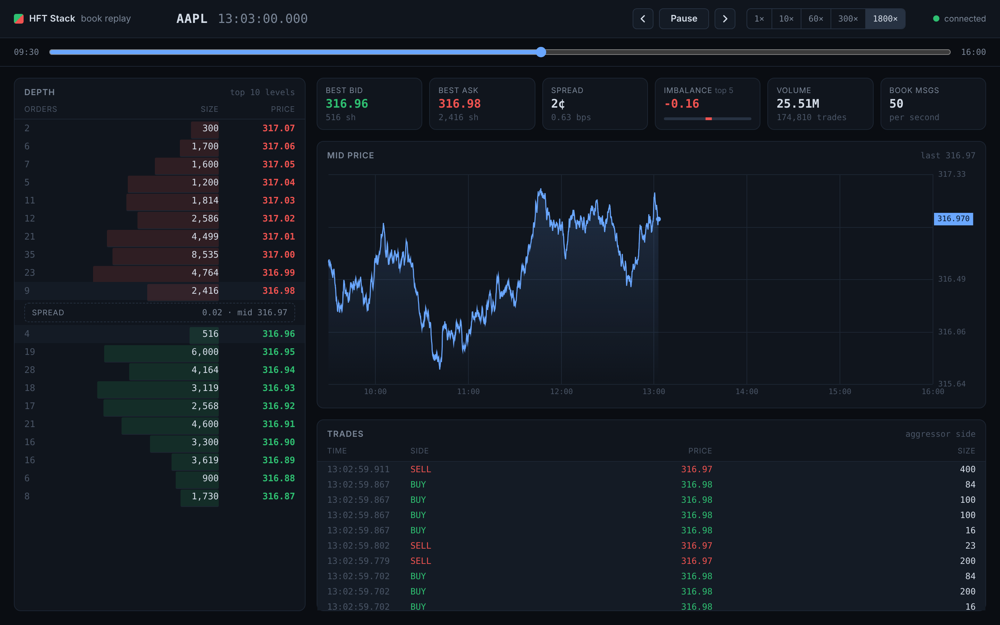

# HFT Stack: Phase 1, market data and order book

A from-scratch, low-latency **Nasdaq TotalView-ITCH 5.0 feed parser and full-depth order book** in C++20, with tests, benchmarks, and a web viewer for replaying the book.

This is Phase 1 of a larger project: an exchange simulator plus a trading engine that trades against it. Every later phase builds on this one.



## What's inside

| Path | What it is |
|---|---|
| `include/hft/itch/` | ITCH 5.0 message definitions, zero-copy parser, encoder |
| `include/hft/book/` | L3 order book: order pool, per-level FIFO queues, two price-level containers |
| `include/hft/common/` | Big-endian loads, mmap file, open-addressing hash map, TSC timing, latency histogram |
| `include/hft/sim/` | Reproducible RNG and a synthetic ITCH day generator |
| `src/tools/` | The `itch` CLI: `gen`, `stats`, `replay`, `snapshot` |
| `tests/` | GoogleTest: parser round-trips, book scenarios, **differential test** against a naive reference |
| `bench/` | Data-structure benchmarks: vector vs `std::map` levels, flat hash map vs `std::unordered_map` |
| `viewer/` | Node WebSocket server + browser UI (depth ladder, mid chart, trade tape) |
| `docs/phase1-design.md` | Why each design choice was made, plus the interview questions it prepares you for |

## Quick start

You need Linux or macOS (on Windows, use **WSL2 with Ubuntu**), a C++20 compiler (GCC 11+ or Clang 14+), CMake 3.20+, Node 18+, and git.

```bash
# Ubuntu / WSL2
sudo apt install build-essential cmake git nodejs npm

./scripts/demo.sh        # build, test, generate data, replay, start viewer
# then open http://localhost:8080
```

Or step by step:

```bash
cmake -S . -B build -DCMAKE_BUILD_TYPE=Release
cmake --build build -j
ctest --test-dir build --output-on-failure

./build/itch gen data/synthetic.itch --messages 5000000 --symbols 12
./build/itch stats  data/synthetic.itch
./build/itch replay data/synthetic.itch --symbol AAPL --depth 5 --check
./build/itch replay data/synthetic.itch --latency          # per-message histogram
./build/bench_book

./build/itch snapshot data/synthetic.itch --symbol AAPL --out data/AAPL.jsonl
cd viewer && npm install && node server.js ../data/AAPL.jsonl
```

Viewer keys: **space** play/pause, **← / →** step one snapshot (hold **shift** for 60), **1–5** speed.

## Running on a real Nasdaq trading day

Nasdaq publishes free sample days at `https://emi.nasdaq.com/ITCH/Nasdaq%20ITCH/`, for example `01302019.NASDAQ_ITCH50.gz` (about 4.7 GB compressed, 12+ GB uncompressed).

```bash
cd data
wget "https://emi.nasdaq.com/ITCH/Nasdaq%20ITCH/01302019.NASDAQ_ITCH50.gz"
gunzip 01302019.NASDAQ_ITCH50.gz
cd ..
./build/itch stats  data/01302019.NASDAQ_ITCH50
./build/itch replay data/01302019.NASDAQ_ITCH50 --warm --symbol AAPL --check
./build/itch snapshot data/01302019.NASDAQ_ITCH50 --symbol AAPL --out data/AAPL-real.jsonl
./build/bench_book --file data/01302019.NASDAQ_ITCH50
```

**Your first real test:** on a complete day, `checks: unknown refs` must be 0. Any other value is a bug in the parser or the book. `crossed after add` can legitimately be non-zero around auctions and halts; finding out when it happens is a good exercise.

> The replay needs roughly 1–2 GB of RAM on a real day. Make sure WSL2 has enough memory (`.wslconfig`).

## Commands

```
itch gen      <out.itch> [--symbols 8] [--messages 2000000] [--seed 42]
itch stats    <file.itch>
itch replay   <file.itch> [--book vector|map] [--symbol AAPL] [--depth 10]
                          [--latency] [--warm] [--check] [--reserve 65536]
itch snapshot <file.itch> --symbol AAPL [--interval-ms 1000] [--depth 10]
                          [--from 09:30] [--to 16:00] [--out AAPL.jsonl]
bench_book    [--messages 5000000] [--symbols 8] [--file real.itch] [--runs 3]
```

## Results so far

Measured on a 2-vCPU cloud VM (Intel Xeon @ 2.1 GHz, 4 MB L2), synthetic day, 5M messages, 12 symbols. **Your numbers will differ. Run it yourself and put your own here.**

| Measurement | Result |
|---|---|
| Parse only (decode every message, no book) | **12.8 ns/msg**, 78 M msg/s, 2.6 GB/s |
| Parse + book, vector levels | **48.5 ns/msg**, 20.6 M msg/s |
| Parse + book, `std::map` levels | 64.6 ns/msg (1.33× slower) |
| Order map: `FlatHashMap` vs `std::unordered_map` | 25.3 vs 38.0 ns/op (1.5× faster) |
| Per-message latency, vector book (incl. ~10 ns rdtsc cost) | p50 68 ns · p99 194 ns · p99.9 388 ns |

The hash table's size changes throughput by almost 2×, from the same code:

| `--reserve` | Table size | ns/msg |
|---|---|---|
| 65,536 | 2 MB (fits in L2) | 54.7 |
| 1,048,576 | 32 MB | 77.2 |
| 8,388,608 | 256 MB | 95.5 |

Fibonacci hashing spreads keys across the whole table. A table much larger than the live data turns every lookup into a cache miss. On a real day with millions of live orders the trade-off shifts; measure it yourself.

## Correctness strategy

1. **Unit tests** for each component (parser round-trips for every message type, book scenarios on both level containers).
2. **Differential testing.** Three synthetic days are replayed through the vector book, the map book, and a deliberately naive reference (`std::map` + `std::unordered_map`). The top 10 levels are compared after every message. To check the test itself, a planted one-line bug is caught at message 175.
3. **Invariant checker.** `--check` walks every FIFO and verifies the links, totals, ordering and ref map.
4. **Sanitizers.** `cmake -B build-asan -DCMAKE_BUILD_TYPE=Debug -DHFT_SANITIZE=ON` builds everything with AddressSanitizer and UBSan. All tests pass under them.
5. **Data-quality counters** on every replay (unknown refs, duplicates, overfills, crossed books).

## Exercises before Phase 2

These are the experiments that turn the code into understanding (and into interview answers):

1. Replay a real Nasdaq day. Record throughput and the counters. Which message types dominate?
2. Run `perf stat -e cache-misses,branch-misses ./build/itch replay ...` for both `--book` options. Explain the difference.
3. Replace the linear scan in `VectorLevels::find` with `std::lower_bound`. Is it faster? On which data?
4. Add a third level container: a flat array indexed by price tick around the current mid. Benchmark all three.
5. Find the order that waited longest in the queue before being filled, using `queue_position` and timestamps.
6. Explain the p99.99 and max latencies in the histogram (page faults? the VM? rehashing?), then make them smaller.

## Roadmap

- [x] **Phase 1:** ITCH parser, order book, replay, benchmarks, viewer
- [ ] **Phase 2:** matching engine (exchange simulator) with differential fuzz testing
- [ ] **Phase 3:** networking: UDP multicast market data (MoldUDP64-style), TCP order entry (OUCH-style)
- [ ] **Phase 4:** trading engine internals: SPSC queues, pinned threads, async logging, live dashboard
- [ ] **Phase 5:** strategy + backtester: market making, queue position, fill model, PnL
- [ ] **Phase 6:** measure and optimize: tick-to-trade latency histograms, perf, huge pages
